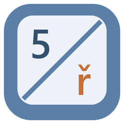
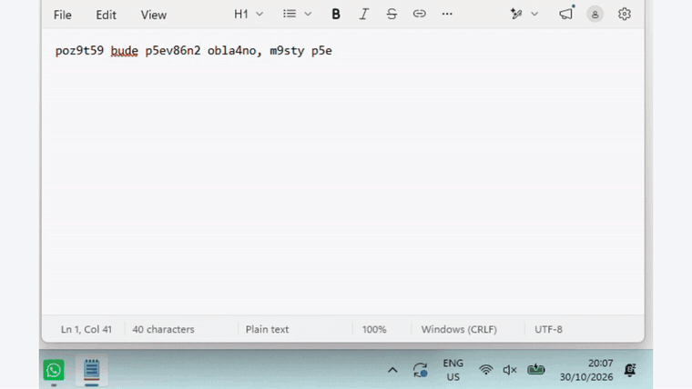

# Přepni

*English: [README.md](README.md)*

Napsal jsi `slo6it8`, protože byla zapnutá anglická klávesnice? **Dvakrát klepni na Shift** a z textu bude
`složitá`, klávesnice se přepne na češtinu a můžeš psát dál. Funguje to i obráceně: `+ěšč` → `1234`.



Každé další dvojí klepnutí přibere o slovo víc, takže jde opravit i celá věta, ale jen tak daleko, jak chceš
(„ta 2 bude dost slo6it8“: dvojka zůstane dvojkou). Delší text stačí **označit** a dvakrát klepnout na Shift:
převede se celý, a správným směrem i napůl opravená věta. A když se oprava nepovede, vrátí ji Ctrl+Z.

## Stažení

Hotový `Prepni.exe` je u [posledního vydání](../../releases/latest): jeden soubor kolem 1,5 MB, nic se
neinstaluje a .NET není potřeba. Po spuštění se objeví ikonka v oznamovací oblasti; v její nabídce jde zapnout
spouštění s Windows.

Soubor zatím není digitálně podepsaný, takže Windows při prvním spuštění můžou ukázat varování SmartScreen
(„Další informace“ → „Přesto spustit“). Kdo nechce věřit cizímu exe, může si ho postavit sám, viz níž.

## Jak to funguje

Aplikace si nepamatuje znaky, ale **fyzické klávesy** posledních slov. Při opravě přepne okno s fokusem do
druhého rozložení, smaže původní text a zmáčkne stejné klávesy znovu, tempem rychlého písaře. Znaky z nich
udělají Windows samy, i s mrtvými klávesami (`+` a `n` je na české klávesnici `ň`). Nepotřebuje slovník ani
převodní tabulky: funguje s jakoukoli dvojicí rozložení, české QWERTZ i QWERTY, slovenské, německé…

| Projekt | Co obsahuje |
|---|---|
| `src/Prepni.Core` | Převod kláves mezi rozloženími, mrtvé klávesy, poslední slova, směr převodu. Bez Windows, pokryté testy. |
| `src/Prepni` | Aplikace v oznamovací oblasti přímo nad Win32 (bez WinForms): háček klávesnice, dvojí Shift, `SendInput`, schránka. Native AOT: malý exe, okamžitý start, kolem 14 MB paměti. |
| `tests/Prepni.Core.Tests` | Unit testy (xUnit). |
| `video/` | Ukázkové video: úvod a závěr v Remotion, vlastní 8bitová znělka z Pythonu. |

## Soukromí

Aplikace technicky sleduje klávesnici, a tak je dobré vědět přesně, co dělá:

- Pamatuje si jen **posledních pár slov, jen v paměti**. Nic neukládá na disk a nic neposílá.
- Paměť se maže při Enteru, kliknutí myší, přepnutí okna, klávesové zkratce nebo šipkách.
- Označený text si půjčí přes schránku (Ctrl+C) a schránku pak vrátí, jak byla.
- Dokud běží, vypne zkratku Windows „pětkrát Shift = Jedno stisknutí“, se kterou se dvojí Shift tluče; při
  ukončení ji vrátí. Kdo Jedno stisknutí používá, tomu ji nechá.
- Celý kód je tady, ať se dá zkontrolovat.

## Spuštění

```bash
dotnet test
dotnet run --project src/Prepni
```

Vydání přes Native AOT (`dotnet publish src/Prepni -c Release -r win-x64`) potřebuje C++ nástroje Visual
Studia. Tag `v*` postaví `Prepni.exe` v GitHub Actions a přiloží ho k vydání. Pro test celé cesty bez člověka
u klávesnice: `PREPNI_TEST_INPUT=1`, háček pak přijme i klávesy od jiného programu.

## Co zatím neumí

- Okna spuštěná jako správce (Windows nedovolí psát do nich z běžné aplikace).
- Neví, kde je kurzor: když v textu skočíš jinam bez myši a šipek (třeba Ctrl+Z), oprava může zasáhnout špatné místo.
- Pole pro heslo zatím nepozná.
- Ve Visual Studiu a VS Code kopíruje Ctrl+C bez označení celý řádek; to aplikace pozná a nic nepřepíše.
  Jiné editory s podobným chováním zatím nezná.
- V IDE od JetBrains otevře dvojí Shift zároveň Search Everywhere.

Mimochodem: kdo napíše název na anglické klávesnici, dostane `P5epni`. I to Přepni opraví.

## Licence

[MIT](LICENSE) · autor [Martin Hájek](https://martinhajek.dev)
