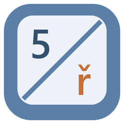
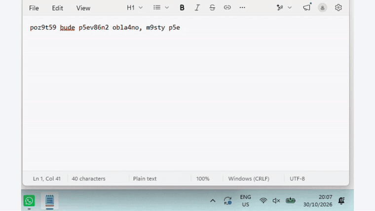

# Přepni

*Česky: [README.cs.md](README.cs.md)*

Typed a whole sentence before noticing the wrong keyboard layout was on? **Double-tap Shift** and Přepni
retypes it as you meant it, then switches the layout so you can keep typing.



▶ [30-second video on YouTube](https://youtu.be/mPb9Ls7TXOU)

- **Last word:** double Shift fixes the word you just typed. Each further double Shift takes one more word,
  so you fix exactly as much as you need ("ta 2 bude dost slo6it8": the real "2" stays a 2).
- **Selection:** select any text and double Shift converts all of it. The direction is decided by the text,
  so a half-fixed sentence still comes out right.
- **Both ways:** `slo6it8` → `složitá` on a US layout, and `+ěšč` → `1234` when Czech was on.
- **Any pair of layouts:** it doesn't use dictionaries or conversion tables, it replays your physical keys
  in the other installed layout. Czech, Slovak, German, Polish, Russian…
- **Undo:** didn't want that? Ctrl+Z.

It's made for people who write code on a US layout and messages in their own language.
(The name means "Switch!" in Czech. Type it on a US layout and you get `P5epni`, which Přepni fixes too.)

## Download

Get `Prepni.exe` from the [latest release](../../releases/latest): a single 1.5 MB file, nothing to
install, no .NET runtime needed. A tray icon appears; its menu can pause the app or start it with Windows.

The executable isn't code-signed yet, so Windows SmartScreen may warn on first run
("More info" → "Run anyway"). If you'd rather not trust a stranger's binary, build it yourself (below).

## How it works

Přepni remembers the **physical keys** (scan codes) of the last few words, not the characters. On double
Shift it switches the focused window to the other layout, deletes the text and presses the same keys again,
at a fast typist's pace. Windows itself turns them into the right characters, including dead keys
(`+` then `n` on a Czech layout is `ň`).

A few things that turned out to matter, mostly learned from Windows 11 Notepad:

- **Real keys, not Unicode packets.** Sending characters with `KEYEVENTF_UNICODE` in a batch made Notepad
  read all of them as the last one. Replaying scan codes, with Shift held for a moment, works everywhere.
- **The focused window, not the top-level one.** Notepad's text box runs on a different thread from its main
  window, and the keyboard layout belongs to the thread. Switching the main window had no effect.
- **Hooks on their own thread.** Windows silently removes a low-level hook that is slow to respond. The hooks
  run on a dedicated thread, and the app reinstalls them if Windows ever drops them.

| Project | Contents |
|---|---|
| `src/Prepni.Core` | Converting keys between layouts, dead keys, the last typed words, conversion direction. No Windows dependencies, covered by tests. |
| `src/Prepni` | Tray app on plain Win32 (no WinForms): keyboard hook, double Shift, `SendInput`, clipboard. Compiled with Native AOT: small exe, instant start, about 14 MB of RAM. |
| `tests/Prepni.Core.Tests` | Unit tests (xUnit). |
| `video/` | The demo video: intro and outro in [Remotion](https://www.remotion.dev/), an original 8-bit jingle generated in Python. |

## Privacy

Přepni watches the keyboard, so here is exactly what it does with it:

- It keeps only the **last few words, in memory**. Nothing is written to disk or sent anywhere.
- The memory is cleared on Enter, a mouse click, switching windows, keyboard shortcuts and arrow keys.
- To convert a selection it borrows the clipboard (Ctrl+C) and puts the original content back afterwards.
- While running, it disables the Windows "press Shift five times for Sticky Keys" shortcut, which repeated
  double Shifts would trigger, and restores it on exit. If you use Sticky Keys, it's left alone.
- All the code is here, so you can check.

## Build

```bash
dotnet test
dotnet run --project src/Prepni
```

A Native AOT release build (`dotnet publish src/Prepni -c Release -r win-x64`) needs the Visual Studio C++
build tools. Pushing a `v*` tag builds `Prepni.exe` in GitHub Actions and attaches it to the release.

For end-to-end testing without a person at the keyboard, set `PREPNI_TEST_INPUT=1`: the hook then also
accepts keys injected by another program (its own keystrokes are always ignored).

## Not yet

- Windows running as administrator (Windows doesn't let a normal app type into them).
- It doesn't know where the caret is: if you move it without the mouse or arrow keys (e.g. Ctrl+Z), a fix can
  land in the wrong place.
- Password fields aren't detected yet.
- A half-fixed selection in a layout that swaps letters (French AZERTY swaps A/Q, Z/W) can't be told apart from
  a typo without a dictionary; select only the wrong part, or fix word by word.
- Visual Studio and VS Code copy the whole line on Ctrl+C without a selection; Přepni detects that and does
  nothing. Other editors with the same behaviour aren't known yet.
- In JetBrains IDEs, double Shift also opens Search Everywhere.

## License

[MIT](LICENSE) · made by [Martin Hájek](https://martinhajek.dev)
